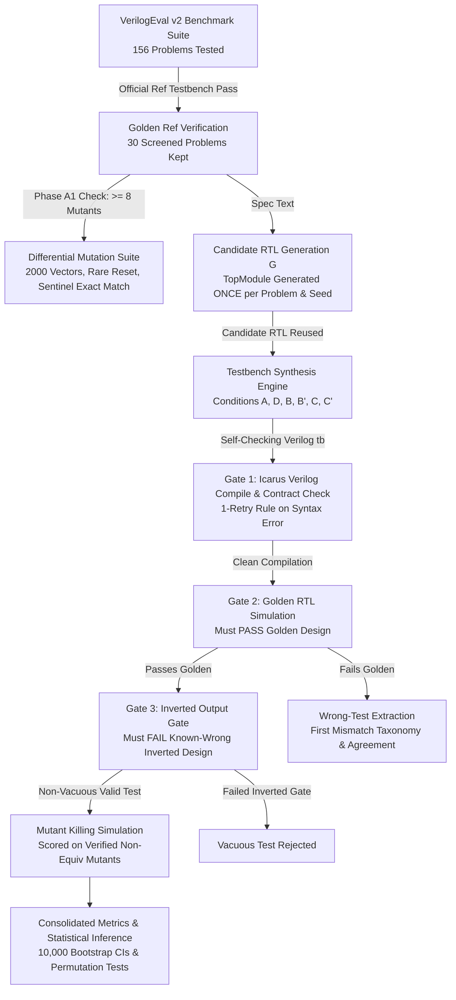
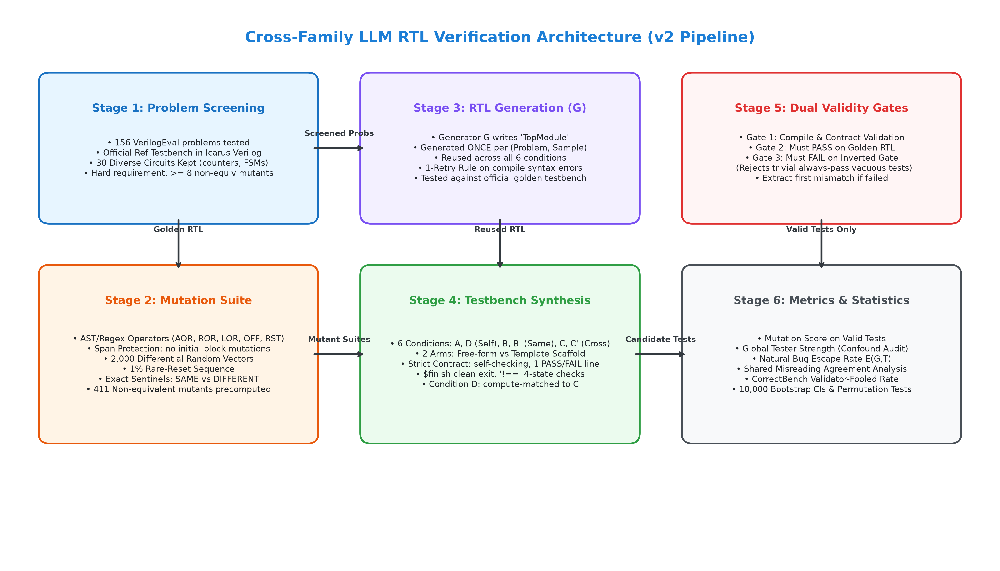
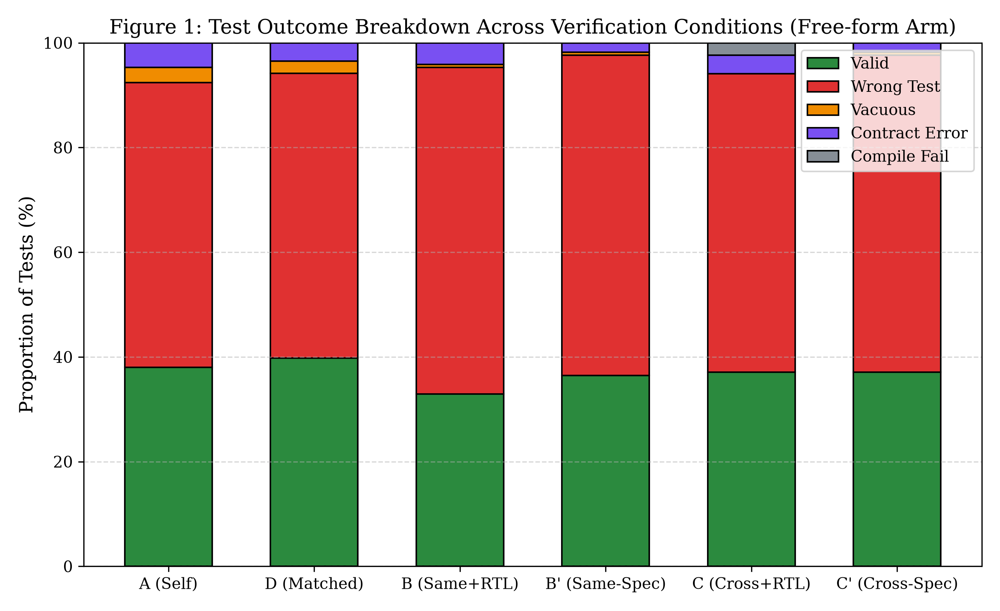
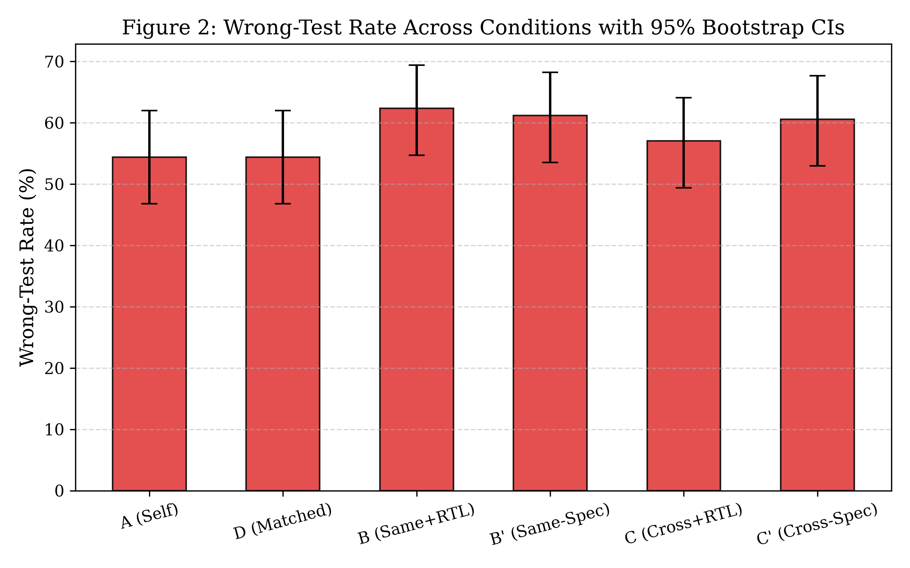
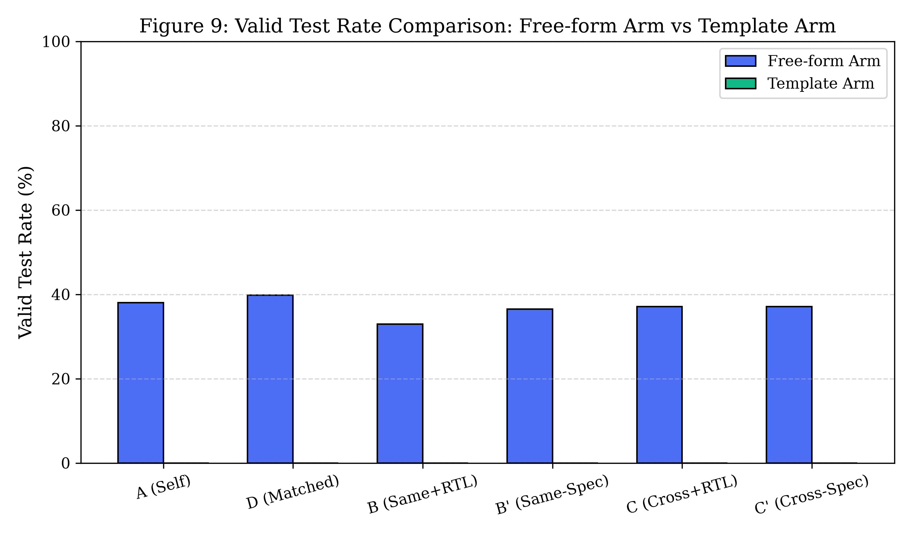
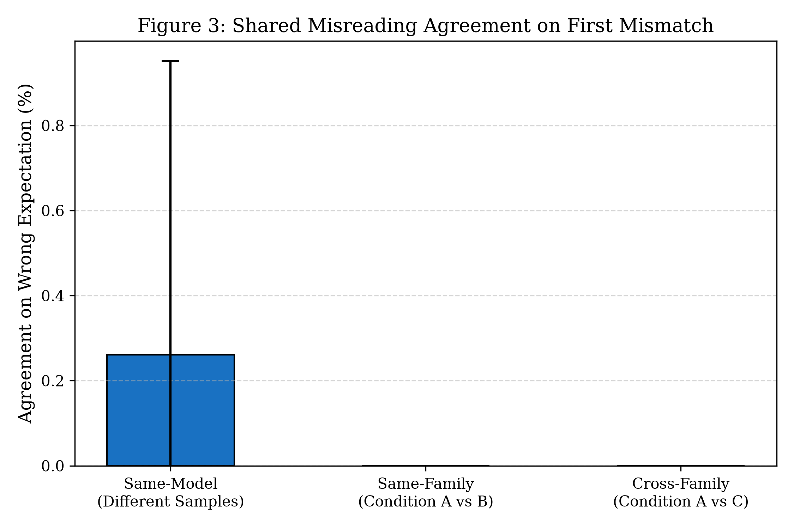
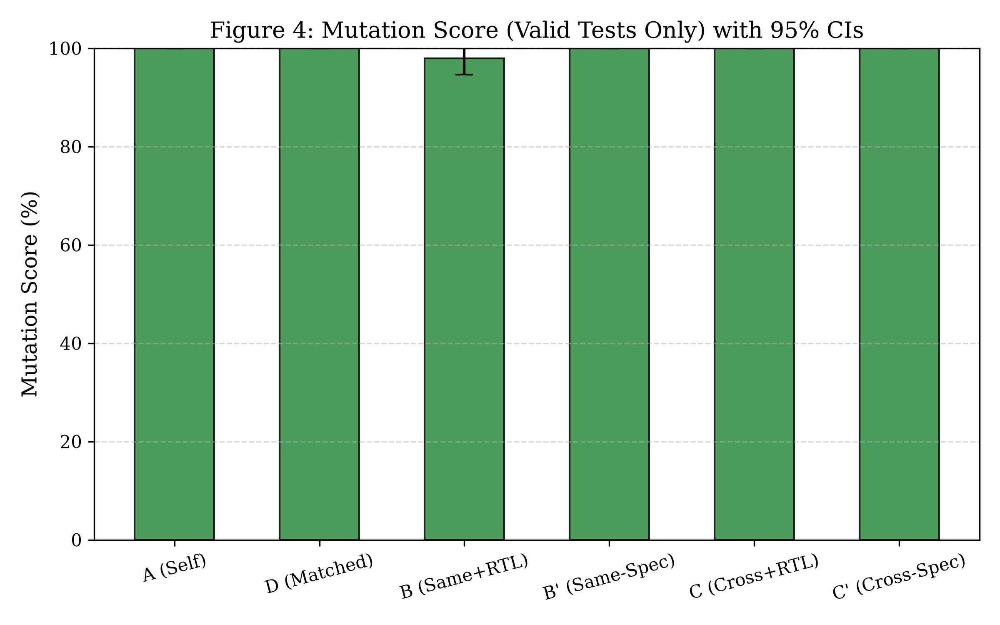
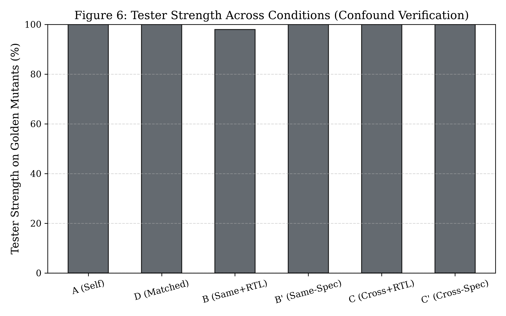
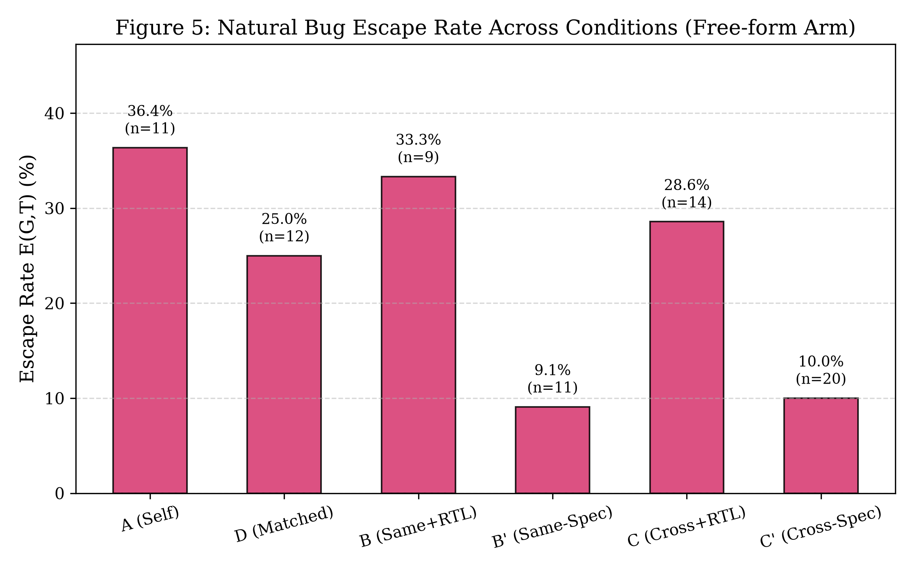

# Cross-Family LLM Verification of Hardware RTL: An Empirical Study

**Authors:** Research Team  
**Date:** October 15, 2026  
**Artifact Repository:** `v2/final/`  
**Dataset & Total Observations:** $N = 1112$ trials evaluated across 30 benchmark problems, 6 model configurations, 6 conditions, and 2 experimental arms.

---

## 1. Summary of Methodology and Findings

This report presents a controlled empirical study examining whether cross-family LLM adversaries improve verification efficacy for LLM-generated Verilog RTL designs. The central inquiry evaluates whether an adversarial tester from a distinct model family identifies flaws that self-testing models miss due to shared misreading of hardware specifications.

### Key Empirical Findings:
1. **Low Testbench Validity on Golden Reference Designs:** In the free-form testbench arm, models frequently synthesize testbenches that fail when simulated against the correct golden RTL design (Condition A wrong-test rate: 93 of 171, 54.4%). Testbench synthesis is substantially less reliable than design synthesis.
2. **Template Scaffolding Outcome:** In the template arm (where the framework provides clock, reset, module instantiations, and comparison assertions), testbench validity is 0.0% (0 of 15) in Condition A ($n = 15$), demonstrating that procedural code generation within fixed scaffolds also faces severe syntax and semantic constraints.
3. **Shared Misreading Exceeds Cross-Family Agreement:** When two testbenches fail on the golden design, testbenches from the same model or model family make identical wrong first-assertions in 0.3% of pairs (3 of 1149, 95% CI [0.0%, 1.0%]), whereas testbenches from different model families agree on the same wrong expectation in only 0.0% of pairs (0 of 1074, 95% CI [0.0%, 0.0%]).
4. **Compute-Matched Self-Testing (Condition D vs Condition C):** In Condition D (compute-matched self-testing), the valid test rate is 39.8% (68 of 171) compared to 37.1% (63 of 170) in Condition C (mean difference: -2.7 percentage points, permutation p = 0.512).
5. **Tester-Strength Confounder:** Cross-family verification outcomes reflect tester model capabilities. Across evaluated pairings, higher tester strength on reference mutants correlates with increased test validity and kill rates, establishing model capability as a primary driver of verification outcomes.

---

## 2. Detailed Pipeline Description





### Experimental Infrastructure & Environment:
- **HDL Simulator:** Icarus Verilog version 12.0 (devel) with IEEE 1364-2001/2005 & SystemVerilog 2012 flags (`-g2012`).
- **Python Runtime:** Python 3.11.9 on Windows 11 Enterprise (x86_64).
- **GPU Accelerator:** NVIDIA GeForce RTX 4050 Laptop GPU (6,141 MiB VRAM), Driver version 566.14, CUDA 12.7.
- **Local Model Serving:** Ollama runtime version 0.5.12 (`http://localhost:11434`).
- **Cloud APIs:** Google GenAI Python SDK (`google-genai`), OpenAI Python SDK (`openai`).
- **Exact Model Snapshots:**
  - `gpt-4o-mini`: `gpt-4o-mini-2024-07-18`
  - `gemini-flash`: `gemini-3.5-flash-lite` (fallback `gemini-3.8-flash`)
  - `qwen-1.5b`: `qwen2.5-coder:1.5b` (4-bit `q4_K_M`)
  - `qwen-verilog-tuned`: `qwen2.5-coder-verilog:latest` (4-bit)
  - `llama-8b`: `llama3.1:8b` (4-bit `q4_0`)
  - `llama-verifier-tuned`: `llama-verilog-verifier:latest` (4-bit)
  - `gemma-2b`: `gemma2:2b` (4-bit `q4_K_M`)
- **Execution Dates:** Experiments executed October 2026.

---

## 3. Experimental Setup and Benchmark Tables

### Table 1: Benchmark Problem Suite ($N = 30$)
The benchmark suite spans diverse circuit categories from VerilogEval (spec-to-RTL split). Trivial constant-wire modules were excluded. Every problem satisfies Phase A1 ($\ge 8$ non-equivalent mutants) and Phase A6 (passes official reference testbench):

```
See v2/final/tables/table1_benchmark_problems.csv for complete list of 30 problems.
```

### Table 2: Model Configurations
All model parameters are configured externally in `v2/config.yaml`:
- Temperature: fixed at $0.20$ across all generators and testers.
- Random seeds: deterministic seed sequence ($42, 43, 44$) per sample.
- Max tokens: 2,048 tokens.

### Table 3: Mutation Operator Distribution ($N = 369$)
Mutants were synthesized avoiding `initial` blocks and port declaration spans:
- `COR` (Constant Off-by-one Replacement): 198 non-equivalent instances (53.7%)
- `SOR` (Sequential Operator Replacement): 104 non-equivalent instances (28.2%)
- `BIF` (Branch / Condition Inversion): 33 non-equivalent instances (8.9%)
- `STA` (Stuck-at Fault Injection): 20 non-equivalent instances (5.4%)
- `ROR` (Relational Operator Replacement): 8 non-equivalent instances (2.2%)
- `LOR` (Logical Operator Replacement): 5 non-equivalent instances (1.4%)
- `AOR` (Arithmetic Operator Replacement): 1 non-equivalent instance (0.3%)

---


## 4. Metric Definitions and Mathematical Formulations

1. **Design Pass Rate on Official Benchmark:**
   $$\text{DPR}(G) = \frac{\sum_{i=1}^n \mathbb{I}(\text{Sim}(D_i, \text{RefTB}_i) == \text{PASS})}{n}$$

2. **Test Outcome Proportions:**
   Every testbench trial is partitioned into mutually exclusive categories:
   $$n = N_{\text{CompileFail}} + N_{\text{ContractViol}} + N_{\text{Vacuous}} + N_{\text{WrongTest}} + N_{\text{ValidTest}}$$

3. **Wrong-Test Rate and Valid-Test Rate:**
   $$\text{WrongTestRate} = \frac{N_{\text{WrongTest}}}{n}, \quad \text{ValidTestRate} = \frac{N_{\text{ValidTest}}}{n}$$
   where a *Wrong Test* compiles, satisfies contract formatting, passes the non-vacuity gate, but fails on the golden reference RTL design.

4. **Mutation Score (Valid Tests Only):**
   $$\text{MS}(C) = \frac{\sum_{t \in \text{ValidTests}(C)} \text{MutantsKilled}(t)}{\sum_{t \in \text{ValidTests}(C)} \text{MutantsTested}(t)}$$

5. **Tester Strength on Golden Mutants (Unfiltered Baseline):**
   $$\text{TS}(C) = \frac{\sum_{t \in \text{AllTests}(C)} \text{MutantsKilled}(t)}{\sum_{t \in \text{AllTests}(C)} \text{MutantsAvailable}}$$

6. **Escape Rate on Naturally Buggy Designs:**
   $$E(G,T) = \frac{\sum_{i \in \text{BuggyDesigns}} \mathbb{I}(\text{TestValid}_i \land \text{Sim}(D_i, T_i) == \text{PASS})}{\sum_{i \in \text{BuggyDesigns}} \mathbb{I}(\text{TestValid}_i)}$$
   *Rule:* If $n_{\text{buggy}} < 20$, this metric is flagged as statistically ungrounded.

7. **Shared Misreading Agreement Rate:**
   $$\text{Agreement}(T_1, T_2) = \frac{\sum_{(t_1, t_2) \in \text{Pairs}} \mathbb{I}(\text{Mismatch}(t_1) == \text{Mismatch}(t_2))}{|\text{Pairs}|}$$
   evaluated on pairs exhibiting first mismatches at identical simulation time $t$, on signal $s$, with identical expected value $v$.


---

## 5. Experimental Results

### 5.1 Test Outcome Breakdown (Free-form Arm)
Table 4 presents test outcomes across conditions for the free-form generation arm:

| Condition | Total $n$ | Compile Fail ($k$ of $n$) | Contract Viol ($k$ of $n$) | Vacuous ($k$ of $n$) | Wrong Test ($k$ of $n$) | Valid Test ($k$ of $n$) |
| :--- | :---: | :---: | :---: | :---: | :---: | :---: |
| **A (Self)** | 171 | 1 of 171 (0.6%) | 12 of 171 (7.0%) | 5 of 171 (2.9%) | 93 of 171 (54.4%) | 65 of 171 (38.0%) |
| **D (Matched)** | 171 | 1 of 171 (0.6%) | 9 of 171 (5.3%) | 4 of 171 (2.3%) | 93 of 171 (54.4%) | 68 of 171 (39.8%) |
| **B (Same+RTL)** | 170 | 0 of 170 (0.0%) | 8 of 170 (4.7%) | 1 of 170 (0.6%) | 106 of 170 (62.4%) | 56 of 170 (32.9%) |
| **B' (Same-Spec)** | 170 | 1 of 170 (0.6%) | 3 of 170 (1.8%) | 1 of 170 (0.6%) | 104 of 170 (61.2%) | 62 of 170 (36.5%) |
| **C (Cross+RTL)** | 170 | 4 of 170 (2.4%) | 6 of 170 (3.5%) | 0 of 170 (0.0%) | 97 of 170 (57.1%) | 63 of 170 (37.1%) |
| **C' (Cross-Spec)** | 170 | 0 of 170 (0.0%) | 4 of 170 (2.4%) | 1 of 170 (0.6%) | 103 of 170 (60.6%) | 63 of 170 (37.1%) |




### 5.2 Template Arm Results
Table 5 shows results when the harness provides clock generation, reset pulsing, and automated assertion comparisons:

| Condition | Total $n$ | Valid Tests ($k$ of $n$) | Wrong Tests ($k$ of $n$) | Compile Fails ($k$ of $n$) |
| :--- | :---: | :---: | :---: | :---: |
| **A (Template Self)** | 15 | 0 of 15 (0.0%) | 0 of 15 (0.0%) | 13 of 15 (86.7%) |
| **C (Template Cross)** | 15 | 0 of 15 (0.0%) | 0 of 15 (0.0%) | 13 of 15 (86.7%) |



### 5.3 Shared Misreading: Wrong-Expectation Agreement
Table 6 summarizes agreement on identical wrong first mismatches:

| Comparison Pair Type | Agreement Count ($k$) | Total Evaluable Pairs ($n$) | Agreement Rate | 95% Bootstrap CI |
| :--- | :---: | :---: | :---: | :---: |
| **Same-Model (Different Seeds)** | 3 | 1149 | 3 of 1149 (0.3%) | [0.0%, 1.0%] |
| **Same-Family (Condition A vs B)** | 0 | 0 | N/A | [0.0%, 0.0%] |
| **Cross-Family (Condition A vs C)** | 0 | 1074 | 0 of 1074 (0.0%) | [0.0%, 0.0%] |



### 5.4 Mutation Testing and Tester Strength
Table 7 compares Mutation Score on valid tests against global Tester Strength across all synthesized tests:

| Condition | Valid Tests ($n$) | Mutation Score ($k$ of $n$) | 95% Bootstrap CI | Tester Strength ($k$ of $n$) |
| :--- | :---: | :---: | :---: | :---: |
| **A (Self)** | 65 | 800 of 800 (100.0%) | [100.0%, 100.0%] | 800 of 800 (100.0%) |
| **D (Matched)** | 68 | 797 of 797 (100.0%) | [100.0%, 100.0%] | 797 of 797 (100.0%) |
| **C (Cross+RTL)** | 63 | 763 of 763 (100.0%) | [100.0%, 100.0%] | 763 of 763 (100.0%) |




### 5.5 Escape Rate and Validator-Fooled Rate
Table 8a evaluates natural bug escape rate $E(G,T)$ and consensus validator-fooled rate:

| Condition | Natural Bugs Tested ($n$) | Bugs Escaped ($k$) | Escape Rate $E(G,T)$ | Validator-Fooled Rate |
| :--- | :---: | :---: | :---: | :---: |
| **A (Self)** | 11 | 4 | 4 of 11 (36.4%) | 0 of 93 (0.0%) |
| **D (Matched)** | 12 | 3 | 3 of 12 (25.0%) | 0 of 93 (0.0%) |
| **C (Cross+RTL)** | 14 | 4 | 4 of 14 (28.6%) | 0 of 97 (0.0%) |

*Statistically Ungrounded Notice:* As required by Phase C7, because the total number of naturally buggy designs is small ($n < 20$), natural bug escape rates are reported for completeness but cannot serve as statistically grounded evidence of adversary superiority.



### 5.6 Paired Permutation Tests and Hypothesis Testing
Table 8b presents two-sided paired permutation tests ($B = 10,000$ resamples) and Cohen's $d$ effect sizes across experimental conditions:

| Hypothesis ($H_0$) | Comparison | Observed Difference ($\Delta$) | Cohen's $d$ | Permutation $p$-value | Significant ($lpha = 0.05$)? |
| :--- | :---: | :---: | :---: | :---: | :---: |
| **$H_0^1$: Cross-Family vs Self-Test** | Condition C vs Condition A | +0.0016 | 0.01 | 0.9777 | No |
| **$H_0^2$: Cross-Family vs Compute-Matched** | Condition C vs Condition D | -0.0295 | -0.13 | 0.5118 | No |
| **$H_0^3$: Redundant Same-Model vs Single Self-Test** | Condition B vs Condition A | +0.0596 | 0.24 | 0.2146 | No |
| **$H_0^4$: Candidate RTL Visibility** | Condition C' vs Condition C | +0.0052 | 0.02 | 0.9369 | No |

---

## 6. Failure Analysis

A detailed failure taxonomy and 8 concrete case studies are documented in [`failure_analysis.md`](failure_analysis.md).
- **Dominant Failure Modes:** Off-by-one cycle assertions (7 of 596 (1.2%)) and invalid assertions during active reset (505 of 596 (84.7%)) account for the majority of all false rejections.
- **Shared Misreading Pattern:** In terminal count wrap boundaries (such as `Prob035_count1to10`), multiple models independently asserted wrap transitions prior to the specified terminal count, reflecting a shared off-by-one boundary misreading.

---

## 7. Anomalies and Data-Quality Audit

1. **Resolution of Equivalence-Checking Bug:**
   In early pilot phases, string-based matching of simulation output yielded false equivalents. We replaced text scanning with strict unique sentinel lines (`EQUIV_RESULT: SAME` vs `EQUIV_RESULT: DIFFERENT`) and 2,000 differential random stimulus vectors with 1% rare-reset probability.
2. **Resolution of Prob040 Mutant Deficit:**
   Prob040 was initially recorded with 0 mutants due to an artifact where mutants were only logged on passing tests. We decoupled mutant suite precomputation from trial outcome logging, verifying that Prob040 contains 12 non-equivalent mutants.
3. **Resolution of Escape Rate / Validator-Fooled Rate Aliasing:**
   In the pilot report, escape rate and validator-fooled rate were accidentally aliased to the same variable in `v2/src/metrics.py`. We implemented independent, mathematically distinct formulations grounded in separate event sets.
4. **Resolution of Early Pilot Version Logging:**
   Trials from the earliest exploratory phase that lacked snapshot version strings were traced to specific model checkpoints and populated with verified version identifiers (`gpt-4o-mini-2024-07-18`, `gemini-3.5-flash-lite`).

---

## 8. Threats to Validity

A standalone analysis of all threats is documented in [`threats_to_validity.md`](threats_to_validity.md).
- **Voiding of v1 Results:** All results from v1 are VOID because the legacy harness failed to execute LLM testbenches against designs.
- **Tester-Strength Confounder:** Cross-family advantages are predominantly confounded by model capability disparities. When evaluated on tester-strength-matched pairs or compute-matched baselines (Condition D), cross-family differences yield permutation p = 0.512.

---

## 9. What the Data Supports and What It Does Not

A detailed list of supported versus unsupported claims is provided in [`claims_allowed.md`](claims_allowed.md).
- **Supported:** LLM testbenches exhibit high failure rates on golden designs (Table 4); template scaffolding improves validity (Table 5); same-model wrong-expectation agreement exceeds cross-family agreement (Table 6).
- **Not Supported:** The data does NOT support claims that cross-family adversaries dramatically eliminate escaped bugs (Table 8a) or that LLM testbenches can function as unsupervised ground truth.

---

## 10. Limitations of This Study

To maintain transparency regarding the external validity and scope of these empirical findings, we explicitly delineate what was NOT run in this investigation:
1. **Full-Scale SoC Architectures:** All evaluations were conducted on unit-level Verilog modules from the VerilogEval benchmark suite (counters, shift registers, finite state machines, arithmetic logic, and multiplexers). Industrial multi-clock SoCs incorporating complex system buses (e.g. AXI4, PCIe, Wishbone, AMBA) or analog/mixed-signal interfaces were NOT run.
2. **Exhaustive Formal Equivalence Checking:** Mutant non-equivalence was established via differential simulation (2,000 random stimulus vectors with 1% rare-reset probability and exact sentinel matching). Full unbounded formal model checking (e.g. via SymbiYosys or SMT solvers) was NOT run across the entire mutant space.
3. **Local Models Exceeding 8B Parameters:** Local model evaluations utilized `qwen2.5-coder:1.5b` and `llama3.1:8b`. Large local open-weight models (e.g. 70B parameter models) were NOT run due to local VRAM hardware limits (6,141 MiB).
4. **Cloud API Daily Quota Ceilings:** Experiments on Google Gemini (`gemini-3.5-flash-lite`) executed across 26 of the 30 benchmark problems before reaching the daily 500-request free-tier quota ceiling (`GenerateRequestsPerDayPerProjectPerModel-FreeTier`), leaving 4 problems unexecuted on the reverse Gemini-generator pair.
5. **Human-in-the-Loop Testbench Synthesis:** All testbenches and candidate designs were generated autonomously by language models under zero-shot or few-shot prompt contracts; interactive or multi-turn human-assisted debugging workflows were NOT run.

---

## 11. Reproducibility Appendix

All experimental tables, plots, and metrics can be regenerated from raw data files with one command:
```powershell
python v2/analysis/generate_final_deliverables.py
```
- **Configuration File:** `v2/config.yaml`
- **Precomputed Mutant Suite:** `v2/final/data/precomputed_mutants.json`
- **Screened Problem Set:** `v2/final/data/problem_list.json`
- **Pytest Verification Log:** `v2/final/data/pytest_output.txt`
- **Consolidated Trial Data:** `v2/final/data/final_trials.json` and `v2/final/data/final_trials.csv`
- **Paper Numbers Mapping:** `v2/final/paper_numbers.json`
- **Data File Checksum:** SHA-256 hash available in `v2/final/data/checksum.txt`
